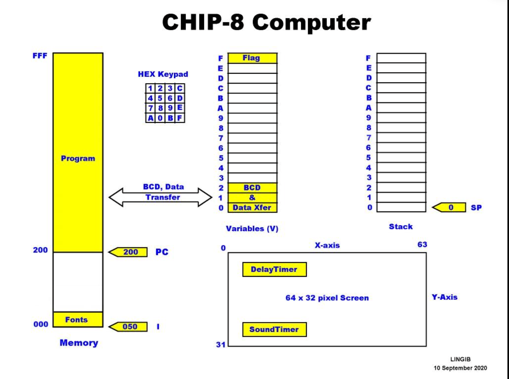
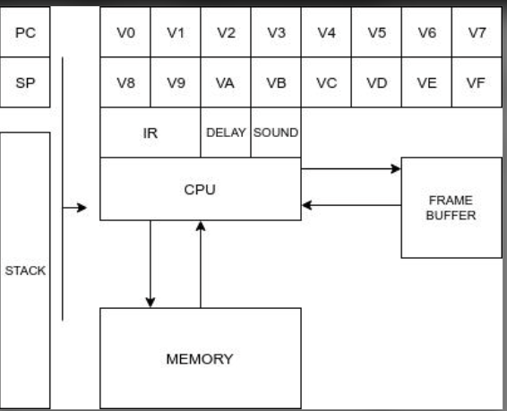
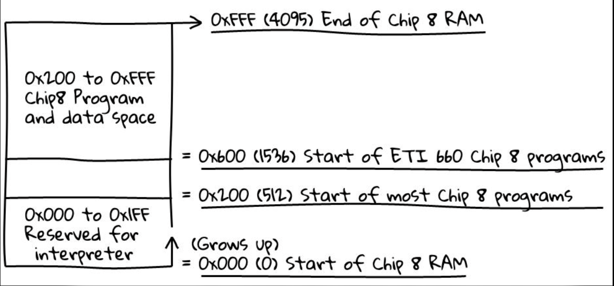

## Apa itu Emulator State?

### Apa sebenernya yang kita buat?

Sebelum menulis emulator, kita perlu memahami bahwa emulator adalah program yang meniru keadaan dan perilaku mesin lain menggunakan komputer kita.

Kita dapat membayangkan CHIP-8 sebagai mesin kecil yang mempunyai:

- CPU state: register dan program counter
- Memory: tempat menyimpan program dan data
- Stack: tempat menyimpan return address
- Display: tempat menyimpan pixel
- Input: keadaan tombol keyboard
- Timer: delay dan sound timer
  Semua komponen tersebut merupakan state dari CHIP-8.

### Apa itu state?

State adalah kondisi atau keadaan suatu sistem pada waktu tertentu.
Contoh:

```
Lampu:
    state = ON

Motor:
    state = RUNNING

CHIP-8:
    PC = 0x200
    V0 = 0
    V1 = 0
    Memory = 4096 bytes
```

Jika sebuah instruksi mengubah V0 dari 0 menjadi 10, berarti state emulator berubah. Dengan demikian, tujuan awal kita adalah membuat struktur data yang mampu merepresentasikan seluruh state CHIP-8.

### Apa itu `struct` dalam Rust?

Dalam Rust, `struct` digunakan untuk mengelompokkan beberapa data menjadi satu tipe.
Contoh:

```rust
struct Person {
  age: u8,
  height: u16
}
```

Kita dapat membuan instance:

```rust
let person = Person {
  age: 20,
  height: 170
};
```

Dalam CHIP-8, kita menggunakan prinsip yang sama:

```rust
struct Chip8 {
  pc: u16,
  i: u16,
  v: [u8; 16]
}
```

Artinya, `Chip8` adalah tipe data yang merepresentasikan state emulator.

### Mengapa kita menggunakan tipe integer berbeda?

Rust memiliki tipe integer yang ukurannya eksplisit.

| Tipe | Ukuran | Rentang unsigned |
| ---- | ------ | ---------------- |
| u8   | 8 bit  | 0-255            |
| u16  | 16 bit | 0-65.535         |
| u32  | 32 bit | 0–4.294.967.295  |
| u64  | 64 bit | 0–2⁶⁴ − 1        |

CHIP-8 menggunakan register 8-bit dan alamat 16-bit.

Karena itu:

- u8 cocok untuk register V0-VF
- u16 cocok untuk Program Counter dan Index Register
- u16 juga digunakan untuk menyimpan opcode CHIP-8 yang berukuran 16 bit.
  Mengapa penting? Karena dalam emulator, ukuran data merupakan bagian dari spesifikasi mesin yang kita tiru.

### Apa itu array?

`Array` merupakan kumpulan elemen dengan tipe yang sama dan ukuran tetap.
Contoh:

```rust
let registers: [u8; 16] = [0; 16];
```

Artinya:

- Tipe elemen: u8
- Jumlah elemen: 16
- Semua elemen awalnya bernilai 0.
  Dalam CHIP-8, register V0 sampai VF memiliki 16 registers.

Maka:

```rust
v: [u8; 16],
```

merupakan representasi langsung dari register tersebut.
Hal yang sama berlaku untuk memory:

```rust
memory: [u8; 4096]
```

CHIP-8 memiliki 4096 byte memory.

## Mengapa display menggunakan `[[bool; 64]; 32]`?

Display CHIP-8 memiliki resolusi:

- Lebar: 64 pixel
- Tinggi: 32 pixel
- Monochrom: pixel hanya ON/OFF
  Dalam rust:

```rust
display: [[bool; 64]; 32]
```

Ini adalah array 2 dimensi. Contoh:

```rust
display[y][x]

display[5][10] = true;
```

Artinya pixel pada koordinat (10,5) menyala. Perhatikan bahwa urutannya adalah [y][x], bukan [x][y]
Artinya:

- index pertama menentukan baris
- index kedua menentukan kolom

### Apa itu `impl` dan `new()`?

rust menggunakan `impl` untuk mendefinisikan method yang berhubungan dengan suatu tipe.

```rust
impl Chip8 {
  fn new() -> Self {
    todo();
  }
}
```

`new()` merupakan konvensi Rust untuk membuat instance baru. `Self` di sini berarti tipe `Chip8`. Contoh:

```rust
let c8 = Chip8::new();
```

Artinya kita membuat instance CHIP-8 baru menggunakan fungsi `new()`.

---

### Memahami `V0` sampai `VF`


CHIP-8 memiliki 16 general-purpose register yang masing-masing berukuran 8 bit. Nama register tersebut adalah:

```
V0 V1 V2 V3 V4 V5 V6 V7
V8 V9 VA VB VC VD VE VF
```

Dalam CHIP-8, register ini nantinya digunakan untuk menyimpan data sementara ketika program berjalan.

### Memahami `0x200`

`0x` adalah penanda bahwa angka tersebut menggunakan sistem bilangan hexadecimal (basis 16).

Kita biasa menggunakan decimal (basis 10).

| Decimal             | hexadecimal |
| ------------------- | ----------- |
| 0                   | 0x0         |
| 10                  | 0xA         |
| 15                  | 0xF         |
| 16                  | 0x10        |
| 32                  | 0x20        |
| 256                 | 0x100       |
| 512                 | 0x200       |
| Jadi `0x200` = 512. |

Mengapa CHIP-8 mulai menjalankan program pada alamat `0x200`?

Karena pada CHIP-8 klasik, area memory bagian bawah digunakan untuk interpreter dan data sistem. Program ROM biasanya ditempatkan mulai alamat `0x200`.

Bayankan memory sebagai kumpulan kotak:

```
Memory CHIP-8

0x000 ┌────────────────────┐
      │ Reserved / system  │
0x200 ├────────────────────┤ ← PC awal
      │                    │
      │   Program ROM      │
      │                    │
      │                    │
0xFFF └────────────────────┘
```

Ketika PC bernilai `0x200`, artinya CPU CHIP-8 akan mulai membaca instruksi dari memory index 512.
